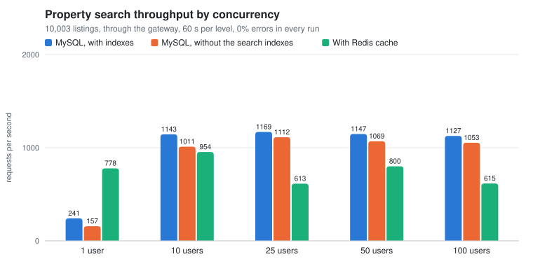
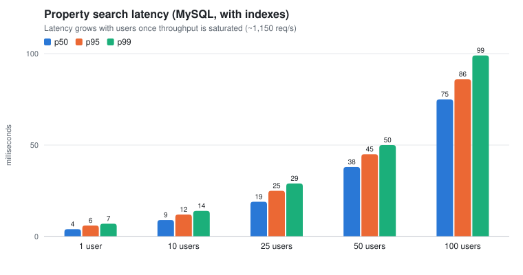
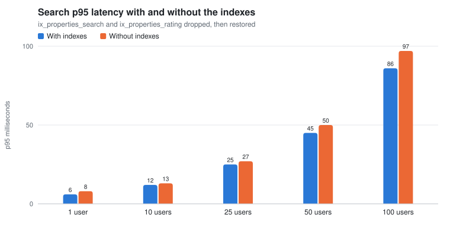
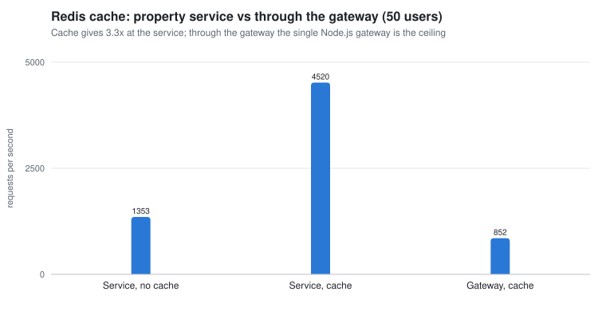
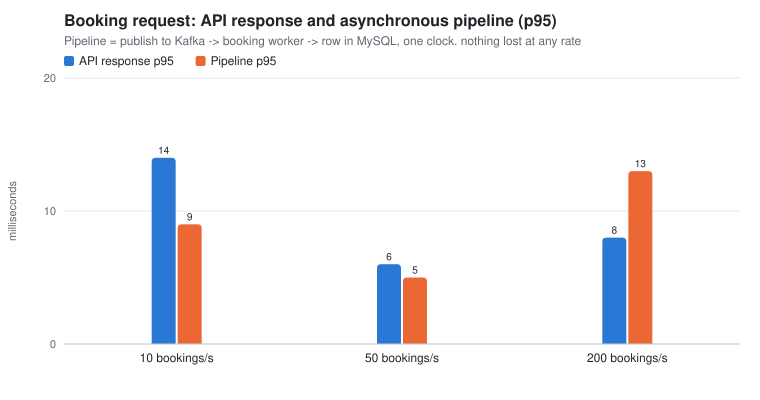
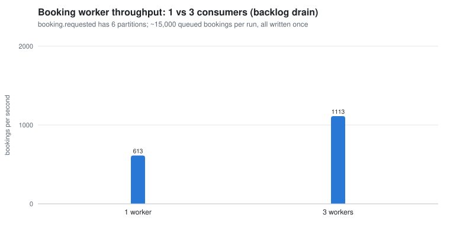
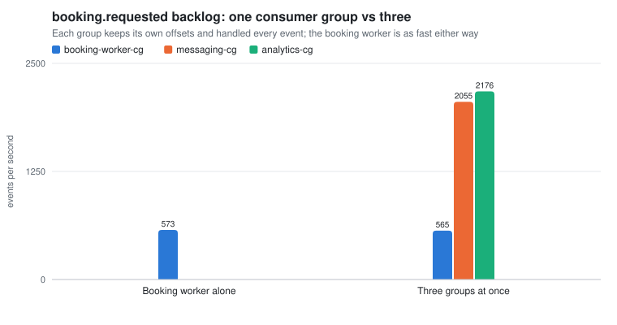
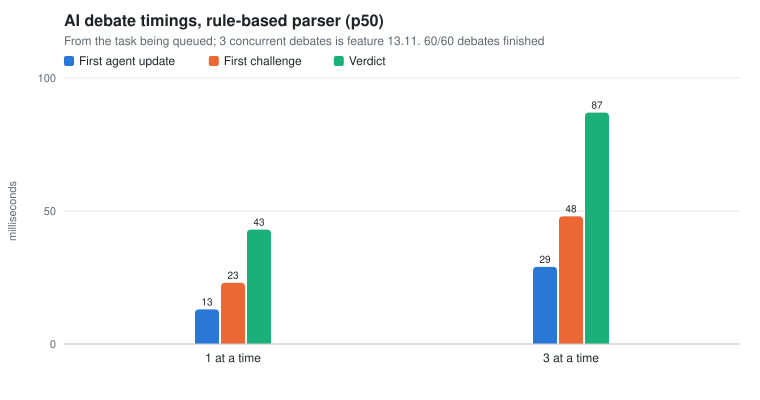

# Performance report (spec §9, Deliverable D)

All numbers below come from the JMeter and Node scripts in `tests/load/`, run on
2026-11-25. Every chart is drawn from the summary CSVs by
`node tests/load/make-charts.js`; the tables repeat the same numbers so nothing
depends on reading a chart. How to rerun each experiment is in
[`tests/load/README.md`](../tests/load/README.md).

## Test setup

| | |
|---|---|
| Machine | Apple M4 Pro, 14 cores, 24 GB RAM, macOS (Darwin 27.2.0) |
| Docker | 29.9.3, Docker Desktop allowed 14 CPUs and 8 GB |
| Load tools | JMeter 5.6.3 (CLI mode), Node v24.21.0 for the timing scripts |
| Dataset | 10,003 active properties (MySQL and MongoDB), seed guests and hosts |
| Entry point | API gateway on `localhost:8080`, rate limit raised for the runs only (`tests/load/docker-compose.loadtest.yml`) |
| Kafka | `booking.requested` has 6 partitions, consumer group `booking-worker-cg` |

**Caveat:** JMeter, the scripts and every container share one laptop. The load
generator takes CPU away from the services, so these are figures for this
machine, not for a production cluster. The comparisons between configurations
are what matter: each pair of runs used the same machine, data and settings,
changing one thing.

Every test user, booking, event and AI task was deleted after the runs
(`node tests/load/booking-setup.js --cleanup`).

## Summary

| Experiment | Result |
|---|---|
| 1. Search throughput | ~1,150 req/s plateau from 10 users up, 0% errors; p95 6 ms (1 user) to 86 ms (100 users) |
| 5a. Indexes | Dropping the two search indexes costs 35% of throughput at 1 user and 5–12% at 10+ users; p95 is 1–11 ms higher |
| 5b. Redis cache | 3.3× throughput at the property service (1,353 → 4,520 req/s), but no gain end to end: the gateway is the ceiling |
| 2. Booking end to end | API p95 6–14 ms; Kafka → worker → MySQL p95 5–13 ms; at 200 bookings/s nothing was lost and the backlog was gone 14 ms after the last request |
| 4. Kafka scaling | 1 → 3 booking workers: 613 → 1,113 bookings/s (1.8×). Three consumer groups on one topic each got every event, and the booking worker kept its speed (573 → 565/s) |
| 6. Failure recovery | Worker killed mid-backlog, and MySQL stopped for 8 s: 0 lost, 0 duplicated in both cases |
| 3. AI debate | Rule-based parser: verdict p50 43 ms (1 debate), 87 ms (3 at once). Local LLM parser: ~10 s per request alone, and 3 of 9 timed out with 3 at once |

## 1. Property search throughput and latency

JMeter sends `POST /api/v1/property/properties/search` through the gateway,
cycling through the same 50 query shapes as `npm run bench:search` (city, dates,
guests, price range, amenities, sort). Each level runs for 60 s with no
think time. The baseline uses MySQL with the cache bypassed
(`X-Cache-Mode: bypass`), so every request reaches the database.

| Users | Requests | Throughput (req/s) | avg | p50 | p95 | p99 (ms) | Errors |
|---:|---:|---:|---:|---:|---:|---:|---:|
| 1 | 14,418 | 240.5 | 4 | 4 | 6 | 7 | 0% |
| 10 | 68,550 | 1,143.2 | 8 | 9 | 12 | 14 | 0% |
| 25 | 70,119 | 1,169.4 | 19 | 19 | 25 | 29 | 0% |
| 50 | 68,767 | 1,146.8 | 40 | 38 | 45 | 50 | 0% |
| 100 | 67,551 | 1,126.5 | 82 | 75 | 86 | 99 | 0% |

Throughput stops rising at about 10 users. After that, adding users only adds
waiting: latency grows roughly in line with the number of users (Little's law
with a fixed ~1,150 req/s), and no request fails. The system degrades by
queueing, not by erroring.

## 5. Configuration comparison: indexes and cache

### 5a. Without the search indexes

`tests/load/run-indexing.sh` drops `ix_properties_search (status, city,
nightly_price)` and `ix_properties_rating (status, rating)`, runs the same
test, and restores both indexes (a shell trap restores them even if the run fails).

| Users | With indexes (req/s) | Without (req/s) | Change | p95 with | p95 without (ms) |
|---:|---:|---:|---:|---:|---:|
| 1 | 240.5 | 156.7 | −35% | 6 | 8 |
| 10 | 1,143.2 | 1,011.1 | −12% | 12 | 13 |
| 25 | 1,169.4 | 1,112.2 | −5% | 25 | 27 |
| 50 | 1,146.8 | 1,069.3 | −7% | 45 | 50 |
| 100 | 1,126.5 | 1,053.2 | −7% | 86 | 97 |

The indexes matter most when a request does not wait in a queue (1 user: each
query costs 50% more without them). Under load the difference shrinks to
5–12%, because with 10,003 rows a full scan of `properties` still fits in the
MySQL buffer pool. The gap would widen with more data.

### 5b. With the Redis cache

Same test with the cache on (`cache_mode=default`; cache-aside, 60 s TTL, see
`docs/slice2-properties-search.md`). End to end, through the gateway, the cache
did **not** raise throughput:

| Users | No cache (req/s) | Cache (req/s) | p95 no cache | p95 cache | p99 cache (ms) |
|---:|---:|---:|---:|---:|---:|
| 1 | 240.5 | 778.0 | 6 | 2 | 2 |
| 10 | 1,143.2 | 954.0 | 12 | 6 | 14 |
| 25 | 1,169.4 | 613.4 | 25 | 14 | 30 |
| 50 | 1,146.8 | 800.1 | 45 | 24 | 37 |
| 100 | 1,126.5 | 615.3 | 86 | 44 | 1,310 |

To find out why, three 20-second runs at 50 users compared the property
service directly (port 8002) with the gateway path:

| Path, 50 users | Throughput (req/s) | p50 | p95 | p99 (ms) |
|---|---:|---:|---:|---:|
| Property service, no cache | 1,352.8 | 37 | 41 | 45 |
| Property service, cache | 4,519.5 | 8 | 10 | 12 |
| Gateway, cache | 851.6 | 15 | 20 | 25 |

At the property service the cache works as designed: 3.3× the throughput and
p95 down from 41 to 10 ms. Through the gateway the cache halves p95 at every
level but the gateway caps throughput. The gateway is one Node.js process
that verifies the JWT, applies the rate limit and proxies every request, so
once MySQL stops being the slow part, the gateway (and JMeter on the same CPU)
is. The cache-on runs were also less steady than the cache-off runs: lower
throughput at 25 and 100 users than at 10 and 50, and a 1.3 s p99 at 100
users. We have not fully explained the cached path being slower than the
uncached path through the gateway; it points to the gateway and the load
generator competing for CPU rather than to the cache, since the service
itself serves cached results 3.3× faster.

**Bottleneck:** MySQL without the cache; the single gateway process with it.
The next step would be running several gateway instances behind a load
balancer (the gateway keeps no state, so this needs no code change).

## 2. Booking: API and asynchronous pipeline

JMeter books at a fixed rate (`ConstantThroughputTimer`), 50 threads, 100 test
guests, 2,000 random active properties, random 1–3 night stays, a fresh
`Idempotency-Key` per request. `booking-e2e.js` then matches every accepted
request to its reservation row.

- **API response:** how long `POST /bookings` takes to answer `202 PENDING` (it
  publishes to Kafka and returns).
- **Pipeline:** from the `booking.requested` event's timestamp to the
  reservation's `booking_datetime` in MySQL, both set by the containers' clock,
  so no clock skew between machines enters the figure. It covers Kafka, the
  booking worker, the availability check and the transaction.

| Target rate | Requests | Accepted (202) | Written | Lost | API p50 | API p95 | API p99 | Pipeline p50 | p95 | p99 | max (ms) |
|---:|---:|---:|---:|---:|---:|---:|---:|---:|---:|---:|---:|
| 10/s | 647 | 647 | 647 | 0 | 9 | 14 | 19 | 4 | 9 | 13 | 16 |
| 50/s | 3,038 | 3,038 | 3,038 | 0 | 5 | 6 | 7 | 2 | 5 | 7 | 11 |
| 200/s | 11,998 | 11,977 | 11,977 | 0 | 4 | 8 | 10 | 3 | 13 | 17 | 45 |

Every accepted booking was written exactly once. The 21 requests not accepted
at 200/s were `409` answers: the random test data happened to send the same
guest to the same property and dates twice while the first request was still
active, which the API rejects by design (API doc §2). After the last request at
200/s, the worker had caught up 14 ms later. The API is faster at 50/s than at
10/s because of warm connections and JIT; the 10/s run is the first after the
warm-up and has fewer samples.

These runs were made before the consumers recorded a trace step per event (the
shared trace-steps change). A 20-second rerun at 200/s with trace steps on gave
the same result (3,992 written, 0 lost) with pipeline p50 6, p95 19, p99 29 ms:
3, 6 and 12 ms more than above, because each step is a MongoDB write on the same
laptop (one shorter run, so a rough comparison).
`TRACE_STEPS=off` turns them off for load tests.

The API's speed does not depend on the worker: the request only publishes to
Kafka. This is the main point of the asynchronous design. Experiment 4 shows
what happens when the worker falls behind.

## 4. Kafka consumer scaling

To measure the worker's capacity rather than the sending rate,
`run-kafka-scaling.sh` stops the booking worker, queues about 15,000 bookings
(30 s at up to 500/s), then starts 1 or 3 workers
(`docker compose up -d --no-recreate --scale booking-worker=N`) and times how
fast the backlog turns into MySQL rows.

| Workers | Bookings queued | Written | Drain time (s) | Bookings/s | Best single second |
|---:|---:|---:|---:|---:|---:|
| 1 | 14,897 | 14,897 | 24.3 | 613 | 770 |
| 3 | 14,900 | 14,900 | 13.4 | 1,113 | 1,447 |

Three workers drain 1.8× faster, not 3×. Each worker took 2 of the 6
partitions, so Kafka spread the work evenly; the limit is MySQL. Every booking
is a transaction that checks and locks nights in `reservation_nights`, and
three workers compete for the same tables in one MySQL instance. More partitions or more workers beyond this would mostly add lock
waits. One worker at 613/s is still three times the 200/s of experiment 2, so
one worker is enough for the demo.

### Consumer groups

Workers in one group share the partitions; separate groups each read the whole
topic. `booking.requested` is read by `booking-worker-cg` (writes the
reservation), `messaging-cg` (opens the guest-host thread), `analytics-cg` (stores
the event) and `notify-cg` (pushes it to the host). `run-consumer-groups.sh`
queues about 7,400 bookings twice: run A with only the booking worker reading,
run B with the booking, messaging and analytics workers starting together. Each
group's rate is measured from its own first and last write (`groups-measure.js`).

| Run | Group | Events handled | Drain time (s) | Events/s |
|---|---|---:|---:|---:|
| A. one group | booking-worker-cg | 7,393 of 7,393 | 12.9 | 573 |
| B. three groups | booking-worker-cg | 7,397 of 7,397 | 13.1 | 565 |
| B. three groups | messaging-cg | 7,397 of 7,397 | 3.6 | 2,055 |
| B. three groups | analytics-cg | 7,397 of 7,397 | 3.4 | 2,176 |

Every group handled every event, and all four groups ended with lag 0. With
two more groups reading the same backlog, the booking worker drained at 565/s
against 573/s alone (1.4% apart, within run-to-run noise): each group keeps its own
offsets, so a new reader does not take events away from the others or wait for
them. The messaging and analytics groups are 3.6 and 3.9 times faster because
each does one MongoDB write, while the booking worker runs a MySQL transaction
that claims nights. Adding a consumer for a new purpose (a new group) is
therefore cheap; adding consumers to an existing group only helps up to the
partition count and the database behind it (above). These runs had trace steps
on, which is why the booking worker is a little slower than the 613/s above.

## 6. Failure recovery

`run-recovery.sh` queues about 10,000 bookings and then breaks something while
the worker drains them. `recovery-check.js` then checks the end state: one
reservation per accepted booking, exactly one status-history row and one
`processed_events` row each, and booked nights that match.

| Failure | Bookings | Reservations | Lost | Duplicated | History rows | Nights wrong | Finished after |
|---|---:|---:|---:|---:|---|---:|---:|
| A. Worker killed with SIGKILL after 3,559 rows, restarted 3 s later | 9,864 | 9,864 | 0 | 0 | 1 each | 0 | 48.6 s after the restart |
| B. MySQL stopped for 8 s after 3,298 rows | 9,894 (6 to the DLQ) | 9,888 | 0 | 0 | 1 each | 0 | 11.7 s after MySQL came back |

**A. Crash.** Nothing was lost or applied twice. About 38 s of the 48.6 s is waiting,
not work: Kafka keeps the killed worker's partitions assigned until its session
times out, and only then does the restarted worker get them. The remaining
~6,300 bookings themselves take about 10 s (experiment 4). No events were
redelivered (0 duplicates logged), because the worker commits each offset right
after its transaction; if one had been, `processed_events` would have caught
it.

**B. Database outage.** The worker retried 21 times (backoff 200 ms × 2ⁿ plus
jitter, delays of 211–994 ms). Three retries cover about 1.5–2 s, shorter than
the 8 s outage plus MySQL's restart, so 6 bookings used up their retries and
went to `booking.requested.dlq` with their original bytes and the reason.
Everything else was written once MySQL was back, and the final state is
exactly consistent. The 6 dead-lettered bookings are accepted (202) but have
no reservation until someone replays the DLQ.

**Trade-off:** a longer retry window would ride out a short outage with nothing
sent to the DLQ, but while one event retries, the worker's other events on that
partition wait. We kept the short window and the DLQ, so a broken event cannot
stall a partition for long.

The single-booking walk-through for the live demo is `npm run demo:recovery`
(Slice 3).

## 3. AI debate timings

`ai-timings.js` submits a trip request through the gateway as a test guest,
opens the task's WebSocket stream and records, from the task's `QUEUED` frame
(server clock): the parser result, the first agent update, the first challenge
and the verdict. Three concurrent debates is feature 13.11.

| Parser | Debates at once | Finished | Parse p50 | First agent p50 / p95 | First challenge p50 / p95 | Verdict p50 / p95 (ms) |
|---|---:|---:|---:|---:|---:|---:|
| Rule-based (default) | 1 | 30/30 | – | 13 / 18 | 23 / 29 | 43 / 50 |
| Rule-based (default) | 3 | 30/30 | – | 29 / 54 | 48 / 70 | 87 / 102 |
| qwen3:8b via Ollama | 1 | 10/10 | 9,911 | 9,920 / 15,031 | 9,932 / 15,047 | 9,955 / 15,071 |
| qwen3:8b via Ollama | 3 | 6/9 | 24,537 | 24,547 / 29,172 | 24,562 / 29,184 | 24,586 / 29,206 |

With the rule-based parser the whole debate finishes in under 0.1 s, even with
three at once. With a local LLM as the parser, parsing is almost all of the
time: the agents, challenges and verdict add about 45–50 ms after it. With 3 at
once the requests queue for the one local model, and 3
of 9 tasks reached the 30 s parse deadline and ended `TIMED_OUT` (as designed:
the user gets a clear failure rather than waiting forever). Three LLM parses
also hit the 15 s `LLM_TIMEOUT_S` and fell back to the rule-based parser.

**WebSocket delivery:** frames reach the browser about 110–240 ms after they
are created (p95 224–254 ms). The stream checks MongoDB for new frames every
250 ms (`STREAM_POLL_S=0.25`), so delivery is bounded by the poll interval,
not by the network. A lower interval or a change stream would cut this at the
cost of more database reads.

**Bottleneck:** the LLM parser. The demo uses the rule-based parser.

## Bottlenecks found

| Where | Evidence | What would help |
|---|---|---|
| MySQL, search without cache | Plateau at ~1,150 req/s from 10 users | Redis cache (3.3× at the service) |
| Gateway, search with cache | 4,520 req/s at the service, ~850 through the gateway | More gateway instances |
| MySQL, booking writes | 3 workers give 1.8×, not 3× | Fine for the demo; shard nights or batch writes beyond that |
| Kafka rebalance after a crash | ~38 s of the 48.6 s recovery is waiting for the session timeout | Shorter session timeout (more false rebalances) |
| Retry window vs database restart | 6 of 9,894 bookings to the DLQ in an 8 s outage | Longer backoff, or a DLQ replay step in operations |
| LLM parser | ~10 s per request alone; timeouts at 3 at once | Rule-based parser, a faster model or a hosted one |
| AI stream poll | WebSocket delivery ≈ poll interval (250 ms) | Lower `STREAM_POLL_S` or a change stream |

## Configuration for the demo

- **Search:** MySQL with both indexes and the Redis cache on. The cache cuts
  p95 by about half at every load level, even where the gateway limits
  throughput, and the cache demo (13.9) needs it.
- **Booking:** one booking worker. It handles three times the highest rate
  tested end to end; a second terminal can scale it to 3 to show partition
  assignment.
- **AI:** the rule-based parser, so a debate finishes in under 0.1 s and the
  demo does not depend on a local model. The LLM parser is shown as an option.
- **Gateway:** the normal rate limit; the raised limit is only in the
  load-test override file.

## Files

| | |
|---|---|
| Test plans | `tests/load/search.jmx`, `tests/load/booking.jmx` |
| Runners | `run-search.sh`, `run-indexing.sh`, `run-booking.sh`, `run-kafka-scaling.sh`, `run-consumer-groups.sh`, `run-recovery.sh`, `ai-timings.js` |
| Checks | `booking-e2e.js`, `drain-measure.js`, `groups-measure.js`, `recovery-check.js`, `summarize.js` |
| Charts | `tests/load/make-charts.js` → `docs/performance/*.svg` |
| Raw results | `tests/load/results/` (git-ignored: JTL files, summary CSVs, run info) |
